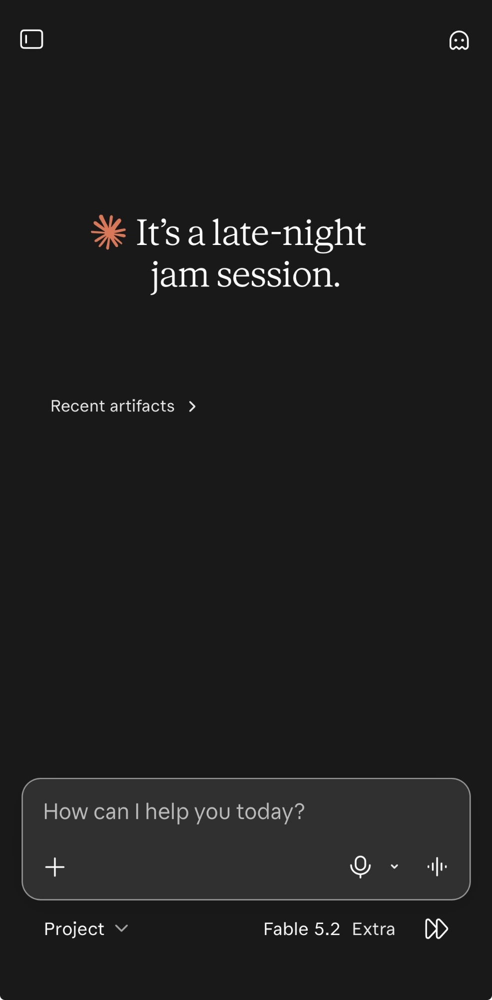
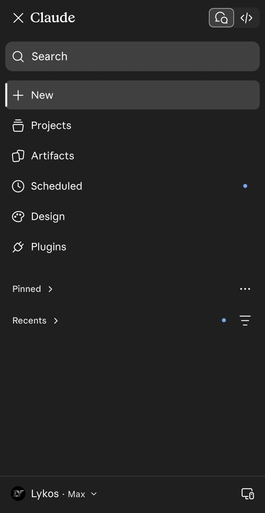
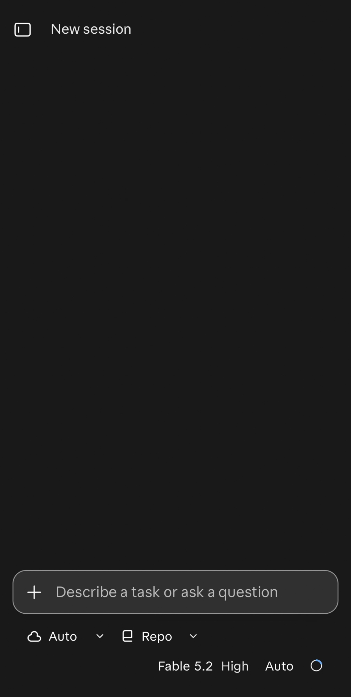

# Lykos (ΛΥΚΟΣ)

**An unofficial iOS app for Claude AI.** Lykos opens claude.ai full screen in its own native iPhone shell: no browser bar, sign in once, and none of the startup code or App Store dependency of a store app.

> **Credit where it belongs.** Claude, claude.ai and everything you use inside this app are made by [Anthropic](https://www.anthropic.com). All credit for Claude goes to them. Lykos is an independent, open-source project: it is not affiliated with, endorsed by or supported by Anthropic. "Claude" and "Anthropic" are trademarks of Anthropic, PBC. Lykos uses no Anthropic logos or artwork.

Lykos (λύκος) is Greek for wolf. It is made by DARK at [Vullki](https://vullki.com) and released under the MIT license.

<p align="center">
  
  
  
  
</p>

## Why it exists

The official Claude iOS app crashed about 0.4 seconds after every launch on an iPhone 17 running an iOS beta, in a monitoring library bundled with the app. Then the App Store wouldn't allow a reinstall because of an Apple Account billing issue. Lykos removes all three dependencies: a store app's release cycle, the App Store, and startup code you don't control. It loads claude.ai directly and can be rebuilt and reinstalled at any time from this repo.

## What it does

- claude.ai edge to edge, respecting the Dynamic Island and the home indicator; the strips around the page take the page's own colour
- Persistent login: sign in once by email code and stay signed in
- Microphone and camera for voice and photos, granted to claude.ai only
- File and photo uploads through the native iOS pickers
- Downloads open the iOS share sheet
- Links outside claude.ai open in Safari, so the app only ever shows claude.ai
- An offline screen with Retry, pull to refresh, and an automatic reload if WebKit's page process crashes
- `lykos://new` opens a new chat (for Shortcuts and other apps)
- A hidden debug log (three-finger long press) that you can share as text

**What it doesn't do:** it isn't a new chat client and doesn't use the Anthropic API. Everything you see is claude.ai itself, served by Anthropic to your own account. There are no analytics, no third-party SDKs, and nothing is collected or sent anywhere except to claude.ai. The only script Lykos adds to the page is a small console bridge for the debug log, which stays on the device.

**Planned:** Face ID lock with an app-switcher privacy cover, a Home and Lock Screen widget, Siri, Shortcuts, Action Button and Control Center, and a share extension.

## Install

Lykos isn't on the App Store. Each person signs their own copy. Every [Release](../../releases) has three files:

| File | Use it with |
| --- | --- |
| `Lykos-<version>-unsigned.ipa` | Sideloadly, AltStore, SideStore, or your own developer certificate |
| `Lykos-<version>.tipa` | TrollStore (the same build, opens straight in TrollStore) |
| `altstore-source.json` | AltStore and SideStore, as a source for one-tap installs and update alerts |

Which route fits your iPhone:

| Your iOS | Routes |
| --- | --- |
| 15.0 to 16.6.1, 16.7 RC, 17.0 | TrollStore (permanent, no re-signing), or any route below |
| Any version from 15.0 | AltStore / SideStore source, Sideloadly, or your own developer account |

Lykos needs iOS 15 or later, iPhone only.

### A. AltStore or SideStore source (one tap, update alerts)

In AltStore or SideStore, go to Sources, tap +, and add:

```
https://github.com/Vullki/lykos/releases/latest/download/altstore-source.json
```

Then install Lykos from the source. New versions show up as updates there. With a free Apple ID the app is signed for 7 days, and AltStore or SideStore refreshes it for you.

### B. TrollStore (iOS 15.0 to 16.6.1, 16.7 RC, 17.0)

Download `Lykos-<version>.tipa` from [Releases](../../releases) on your iPhone and open it in TrollStore. It installs permanently, with no 7-day refresh. TrollStore can't be installed on iOS 16.7.x (except 16.7 RC) or on 17.0.1 and later; use another route there.

### C. Sideloadly or another tool, with a free Apple ID

1. Download `Lykos-<version>-unsigned.ipa` from [Releases](../../releases).
2. Sign and install it with [Sideloadly](https://sideloadly.io) or a similar tool, using your Apple ID.
3. With a free Apple ID the signature lasts 7 days, so refresh it in the same tool before then. Keep the same tool and Apple ID for every refresh: the app's data (your login) is tied to the bundle ID the tool gives it.

### D. Your own Apple developer account, built in the cloud (no Mac)

1. Fork this repo.
2. In your Apple Developer account, register a bundle ID (for example `com.yourname.lykos`) and create a provisioning profile for it with your device.
3. In your fork, go to Settings > Secrets and variables > Actions:
   - **Variable** `LYKOS_BUNDLE_ID`: your bundle ID
   - **Secrets** `CERT_P12_BASE64` (your signing certificate as a base64 `.p12` with its private key), `CERT_PASSWORD`, `KEYCHAIN_PASSWORD` (any strong random string) and `PROFILE_APP_BASE64` (the base64 `.mobileprovision`)
4. Run the **Build** workflow (Actions > Build > Run workflow). The signed job builds `Lykos-signed.ipa`, ready to install with your usual sideloading method.

Without the secrets, the workflow still builds the unsigned IPA, which you can sign yourself, for example with `zsign -k cert.p12 -p <password> -m profile.mobileprovision -o Lykos-signed.ipa Lykos-unsigned.ipa`.

Install the signed IPA as it is. A tool that re-signs it can change the bundle ID, and the app then starts with no login data.

## Signing in and connectors

- Use **Continue with email** and **type the code** into Lykos. Don't tap the link in the email: it opens Safari, and the session lands there instead of in the app.
- Google sign-in isn't available, because Google blocks sign-in inside embedded web views.
- Set up connectors (Gmail, Drive and others) once on claude.ai in a desktop browser. They belong to your account, so they then work in the app. Their sign-in popups can't complete inside a web view.

## How it's built

There's no Mac in this project.

1. Code is written on Windows.
2. `project.yml` describes the Xcode project. [XcodeGen](https://github.com/yonaskolb/XcodeGen) turns it into `Lykos.xcodeproj` on the build machine, so the `.xcodeproj` is never committed.
3. GitHub Actions ([`.github/workflows/build.yml`](.github/workflows/build.yml)) builds on a `macos-26` runner with Xcode 26.6. A build takes under a minute.
4. Pushing a version tag (for example `v0.1.0`) publishes a GitHub Release with the unsigned IPA, the `.tipa` and the AltStore source ([`scripts/altstore_source.py`](scripts/altstore_source.py) reads everything from the built app).

The background is in [Lykos — Project Idea.md](Lykos%20—%20Project%20Idea.md) and [Lykos — Project Plan.md](Lykos%20—%20Project%20Plan.md). Changes are in [CHANGELOG.md](CHANGELOG.md).

## Identifiers

| Item | Value |
| --- | --- |
| Bundle ID | `com.vullki.lykos` for the original build; forks set `LYKOS_BUNDLE_ID` |
| URL scheme | `lykos://` (`lykos://new` opens a new chat) |
| Minimum iOS | 15.0, iPhone only |

## Layout

```
project.yml          XcodeGen spec (targets, settings, Info.plist)
ExportOptions.plist  signed-build export settings (filled in by CI from the profile)
scripts/             package-ipa.sh (.app → .ipa), altstore_source.py (release source)
.github/workflows/   build.yml: the cloud build and tag releases
App/                 the app target
  LykosApp.swift              @main, root view, lykos:// deep links
  WebView/                    web view, delegates, allowed hosts, state, debug log
  Screens/                    launch, offline and debug log screens, colours
  Resources/Assets.xcassets   AppIcon, LykosMark, LaunchBackground
design/icon/         icon sources; final exports in design/icon/final/
docs/screenshots/    README and AltStore screenshots
```

## Status

Version 0.1.0. The shell and the cloud build are done and in daily use on an iPhone 17 running the iOS 27 beta. Not every feature has had a full device test yet: voice, uploads from the camera and Files, and offline Retry are still on the checklist. It builds for iOS 15 and later, but iOS 15 to 26 and TrollStore installs haven't been tried on a real device yet, and neither have other iPhone models. Issues and pull requests are welcome.

## Security

Certificates, passwords and provisioning profiles never go in this repo. `.gitignore` blocks them, and CI reads them only from GitHub encrypted secrets into a temporary keychain that is deleted after every build. Pull requests from forks never receive those secrets.

## License

[MIT](LICENSE) © 2026 Vullki. The license covers the Lykos code and artwork only. It grants no rights to Anthropic's trademarks, claude.ai or any Anthropic service, which stay subject to Anthropic's own terms.
